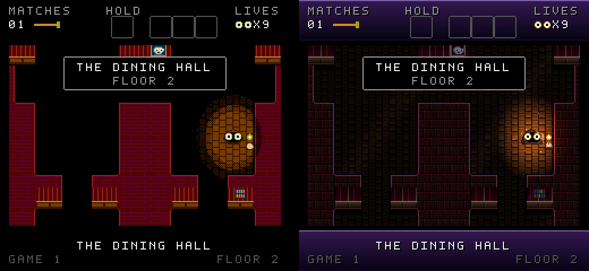
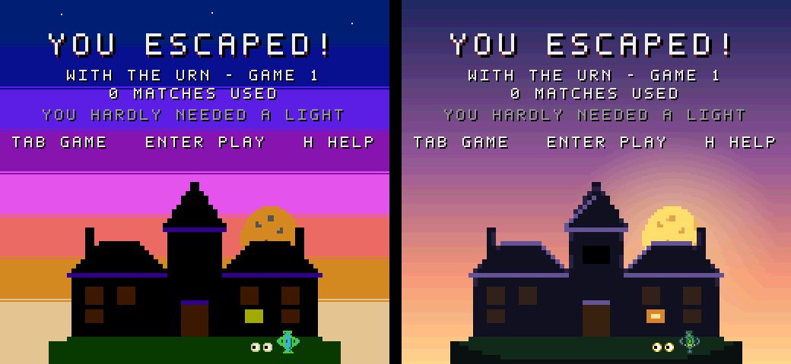

# Haunted House, remastered



Atari 2600 **Haunted House** (James Andreasen, 1982) running *unmodified* in an emulator, with every frame
redrawn live from the game's 128 bytes of RAM. It's the sister project of
[Adventure Forever](https://github.com/majonesmax/adventure-forever), and works the same way.

## Download

**[Get the latest release](https://github.com/majonesmax/haunted-house-remastered/releases/latest)**: one zip
for Windows (64-bit) and one for macOS (Apple silicon: M1 and later). Unzip it and open the app inside. On an
Intel Mac or on Linux, [run it from the source](#running-it-from-the-source) instead.

You need your own copy of the game (the ROM isn't included). The first time, the game asks you to drag the ROM
onto its window, and remembers it after that. **Which ROM:** the NTSC cartridge of Haunted House (Atari
CX2654), MD5 `f0a6e99f5875891246c3dbecbf2d2cea`. Everything here was worked out and checked on that one.

**On a Mac, the first time:** the app isn't signed with an Apple developer ID, so macOS won't open it at
first. It says the app can't be checked for malicious software, or that it "is damaged".

1. Double-click **Haunted House.app** and click **Done** (or **OK**) when macOS refuses.
2. Open **System Settings → Privacy & Security** and scroll down to *"Haunted House" was blocked*.
3. Click **Open Anyway**, then confirm with your password or Touch ID.

After that it opens normally. Or, in Terminal, in the unzipped folder:

```sh
xattr -dr com.apple.quarantine "Haunted House.app"
```

**On Windows, the first time:** the app isn't signed either, so Windows may show *"Windows protected your
PC"*. Click **More info**, then **Run anyway**.

Each release lists the zips' SHA-256 checksums in `SHA256SUMS.txt`. Recording (R) needs
[ffmpeg](https://ffmpeg.org/download.html) installed.

## What it is

Two **looks**, and **L** switches between them while you play:

- **NES**: an 8-bit remaster. A Victorian manor in the NES's 64 colours, a matchlight that dithers into the
  dark, and a gothic chiptune soundtrack.
- **SNES**: a 16-bit remaster. Smooth warm matchlight with dust drifting in it, moonlit walls, a see-through
  ghost, art in 16-bit colour ramps, and the soundtrack and sound effects on a small gothic orchestra.

Both bring the house to life without changing the game: portraits whose eyes follow you, candles that flicker,
a storm outside, rain and creaking floorboards in the quiet attic, a story at the start, and a real ending -
dawn behind the mansion as you walk away with the urn.

The original 2600 picture can run alongside, and a **four-way grid** shows your game, the other look, the
original, and the game's live RAM at once - every byte, what it means, and a log of what happened
([how to read it](docs/reading-the-ram.md)). Gameplay is 100% the original: the emulator runs the real game,
and the remasters only *draw* it.



## How to play

The original kept its rules in the manual, so here they are. In the game, **H** twice shows them too, and
each game number's rules are on the title screen.

- **The goal:** find the three pieces of the urn, join them, and carry the whole urn **out of the front
  door** - on floor 1, the right-hand edge of the room you start in. Holding the whole urn isn't winning;
  getting out with it is. (When the urn comes together, the game reminds you.)
- **Light a match (Space) to see - and to pick anything up.** Things only show close to a burning match,
  and you take one by walking into it while the match is lit. Without a match, you walk straight past.
- **You hold one thing at a time.** Walk into something else (match lit) and you swap. Carry a piece into
  another piece to join them.
- **The pieces are somewhere different every game**, on any of the four floors. The stairs are at the
  rooms' edges: walk off them to climb.
- **A match burns about 20 seconds**, and a monster in the room blows it out. Fewer matches, better score.
  Touch a monster and you lose one of your nine lives. The scepter keeps monsters off you (not the ghost in
  games 8 and 9); the master key opens locked doors (games 3 to 9).
- **Game 1 is the gentlest:** the walls always show. From game 2 the house is dark except in the lightning.

Stuck?

- **G** gives a hint: how many pieces are left and which way the nearest is (up or down the stairs, or which
  way across the floor), how to take it once you're in its room, and with the whole urn, which way to the
  front door. It points; it never marks anything on screen.
- **O** turns the lights on - a cheat, for when you just want to see where everything is. It only shows
  things: **you still need a lit match to pick anything up.**

## Running it from the source

Needs Python 3.10 or newer, and your own copy of the game (the ROM isn't included; [which one](#download)).

```sh
python -m venv .venv
source .venv/bin/activate              # Windows: .venv\Scripts\activate
pip install -r requirements.txt
python tools/get_core.py               # downloads the Stella emulator core for your system into cores/
python play.py                         # drop your ROM onto the window the first time; it's remembered
```

More: `python play.py --look snes`, `--grid`, `--pack <name>`, `--help`. Recording (R) needs
[ffmpeg](https://ffmpeg.org). On Linux, sound needs your distribution's PortAudio (e.g. `libportaudio2`).

## Building the downloads

```sh
pip install -r requirements-dev.txt    # adds PyInstaller
python package/build.py                # -> package/dist/Haunted-House-<version>-<system>-<processor>.zip
```

Run it on each system: PyInstaller can't build for another one, so the Windows download is built on Windows.
Every build bundles the same emulator: Stella `b52ccb02e`, built for each system by Adventure Forever's
"Stella cores" workflow and checked against its checksums by `tools/get_core.py`. (libretro's own macOS
build is stuck at that version and its Windows and Linux builds have moved on, so pinning our own is the only
way every system runs the identical, tested emulator.) The download includes Stella's GPL licence and where
its exact source is.

To check a build without playing it, run the app with `--check`: it plays itself for a few seconds, silently,
and says whether it works, in `self-check.txt` and `self-check.png` in your Pictures folder, under
"Haunted House". On a Mac:
`"Haunted House.app/Contents/MacOS/Haunted House" --check`; on Windows: `"Haunted House.exe" --check`.

GitHub can build the Windows and macOS downloads too, so no one has to build on a PC: the "Downloads"
workflow (`.github/workflows/downloads.yml`). Run it from the Actions tab to try a build, or push a tag to
make a release with both zips, their checksums and the notes in `package/release-notes/<tag>.md`:

```sh
git tag v1.0 && git push origin v1.0
```

If the repository has a `HAUNTED_HOUSE_ROM` secret (the ROM, base64), each build is also run with `--check`.

## Controls

In the game, **H** shows all of these.

| Key | |
|---|---|
| Arrows | move |
| Space | light a match; with one lit, put down what you carry |
| Tab / Enter | GAME SELECT (games 1-9) / GAME RESET (start) |
| L | the next look: NES or SNES (each with its own pack and its own sound chip) |
| V | view: side by side with the 2600 -> the remaster alone -> the 2600 alone -> the grid |
| M | the soundtrack on or off (off leaves the house's own sounds) |
| E | sound: remastered (the default) or the original 2600 sound |
| D | the left difficulty switch: lightning on (the default) or off |
| R | record (videos of each look and the 2600, the sound, the RAM, a log) |
| S / P / F | screenshot / pause / fullscreen |
| G | a hint: which way to the nearest piece of the urn - or, once it's whole, to the front door |
| O | lights on: the whole floor lit and everything on it shown - a cheat, for when you just want to see |
| H | the keys, then how to play |
| Esc | quit |

## How it works

The 2600 has no screen memory. Everything about the game - which floor and room you're in, where the five
items and five monsters are, what you carry, how long the match has left - lives in 128 bytes of RAM. Every
frame we read that RAM through the libretro API and draw our own picture from it, using the ROM's own wall
plan and tables, read from your ROM at run time. The remasters can't change how the game plays, and what
they show follows the original's own rules for what may be seen in the dark.

| Folder | What's in it |
|---|---|
| `game/` | the game itself: the emulator, the RAM map, the ROM's tables, the game's state (`GameState`), the rules for what can be seen, a Python copy of the monster code |
| `looks/` | how it's drawn (the consoles): the look contract (`base.py`), the floor in 3/4 view (`scenery.py`), the NES and SNES looks |
| `content/` | what's drawn: casts (who) and worlds (where), loaded from packs |
| `packs/` | the packs: `classic` (the NES look's) and `nocturne` (the SNES look's), each drawn as text art in `source/` |
| `music/` | the soundtrack (chiptune and orchestra synths), the sound effects, the ambience, and what triggers them |
| `app/` | the window: views, the grid's RAM pane, recording, the ROM |
| `shared/` | pixel-art helpers, palettes, the pixel font, the storm |
| `tools/` | the research checks, the preview, the art and media pipelines |
| `tests/` | pixel-exact "golden" tests of every look, and checks of facing and sound events |

**[A guide to all the documentation →](docs/README.md)**, starting with
[how the game was taken apart](docs/taking-it-apart.md) and [how the code fits together](docs/architecture.md).

## Working on it

The rules for working on it, for people and AI assistants alike, are in [CLAUDE.md](CLAUDE.md): the words
(look, cast, world, pack), the commands, and the rules - never change the game, draw things where the game has
them, reveal only what the original reveals, art is text, and prove nothing else moved.

```sh
pip install -r requirements-dev.txt
python tools/preview.py                # every look in every situation, as one picture - look at it
python tests/golden.py                 # every look still draws exactly the same pixels
python tests/test_hints.py             # G's hints point the right way, in the running game
python tests/test_events.py            # each sound effect fires on the right event
python play.py --check                 # the app plays itself for a few seconds and says whether it works
ruff check --config ruff.toml .        # the readability rules
```

## Licence

The code is MIT ([LICENSE](LICENSE)); the art in `packs/` is CC BY 4.0 ([LICENSE-ASSETS.md](LICENSE-ASSETS.md)).
Not included: Haunted House itself (© 1982 Atari) - bring your own ROM - and the Stella emulator core (GPL-2.0,
downloaded by `tools/get_core.py`).
